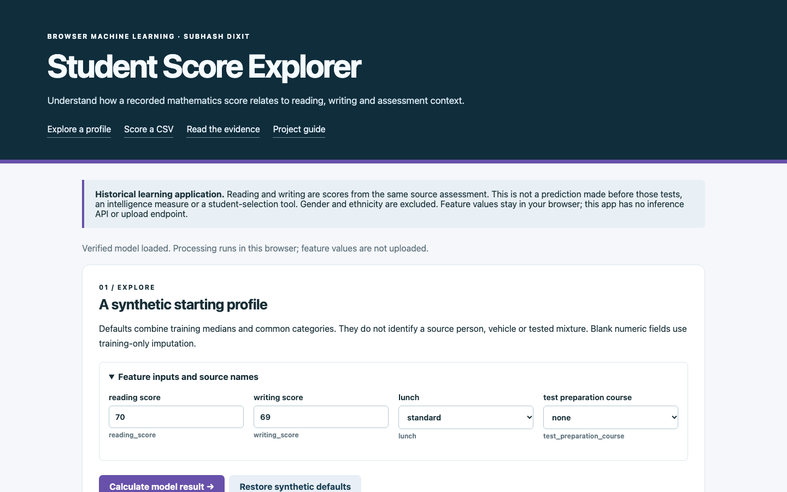
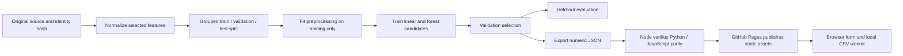
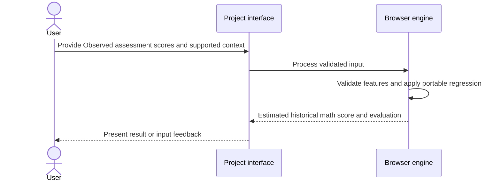
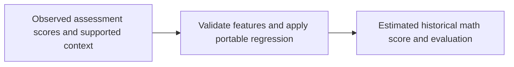
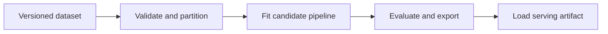
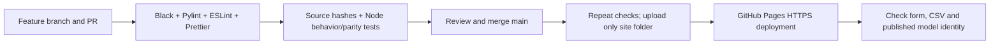

# Student Score Explorer

## 1. Project overview

Student Score Explorer: browser-side model inference, reproducible Python training, measured evaluation and GitHub Pages.

[Live demo](https://subhashdixit.github.io/student-score-explorer/) · [Source repository](https://github.com/subhashdixit/student-score-explorer)



## 2. Motivation and problem statement

### Objective

Study how recorded reading and writing scores relate to the mathematics score in the same assessment.

### Problem statement

Correlated scores collected at the same time can be misinterpreted as a prediction made beforehand.

### Motivation

A held-out association study is useful when the target, input timing, and limitations are stated clearly.

## 3. Solution and scope

**Inputs** — Observed assessment scores and supported context. **Outputs** — Estimated historical math score and evaluation.

### Problem and scope

Reading and writing come from the same source assessment as the mathematics target. This is a cross-score association exercise, not a forecast made before those assessments. Ethnicity, gender and parental education are excluded. Do not use it for admissions, grading or interventions.

Reading and writing are scores from the same source assessment. This is not a prediction made before those tests, an intelligence measure or a student-selection tool. Gender and ethnicity are excluded.

The original repository was `Student_Exam_Performence_End_to_End_Project`. Existing notebooks, Python applications and model files are preserved for context; previous documentation is in `archive/`. The published `site/` uses the documented new model, not an implicitly trusted legacy pickle.

## 4. Quick start and usage

### Use the app

1. Open the GitHub Pages address linked from the repository About section after deployment.
2. Review the synthetic starting profile. Defaults combine training medians and common categories; they do not identify a source record.
3. Change fields and calculate the model result. Blank values use the frozen missing-data representation.
4. Compare the estimate with the held-out error scale; do not interpret MAE as an individual confidence interval.
5. Download the sample CSV, retain all feature headers and upload up to **500 rows / 2 MiB**. The browser worker computes the output locally.
6. Download predictions. The output contains row numbers and results rather than echoing your financial, assessment or sensor inputs.
7. Read the model-selection chart, test results and full machine-readable evaluation in the Evidence section.


**Privacy:** this app has no inference/upload endpoint, analytics script or browser-persistent input store. The static host receives normal asset requests/connection metadata. The local batch worker is terminated after completion or timeout. Reset restores the synthetic form; it does not promise forensic erasure of browser memory. Inputs are validated, not interpreted as executable code.

## 5. High-level architecture

### Architecture: training and serving are separate



GitHub Pages serves static files; it does not run Python. Training is an offline developer operation. The export includes ordered features, medians, means/scales, category vocabulary and model parameters. Browser JavaScript implements the same transformation and prediction. It checks the JSON artifact SHA-256 against the evaluation manifest before enabling prediction.

A hash catches accidental mismatch; it is not independent protection against a malicious change to both files. Source reviews, branch protection and CI provide complementary controls. The app never accepts uploaded model files or executes pickle objects.

## 6. End-to-end request workflow



## 7. Data sources, inputs, and outputs

| Input | Processing | Output |
| --- | --- | --- |
| Observed assessment scores and supported context | Validate features and apply portable regression | Estimated historical math score and evaluation |

### Data and feature contract

- Source file: `notebook/data/stud.csv`.
- Original source rows: **1,000**; valid-target rows used: **1,000**.
- Source SHA-256: `802478d1fb131fea8481d61c88e74d2333d3e5580ff1c13483dda971eed8f880`.
- Selected features: **4**. [Full names, units, categories and bounds](docs/feature-contract.md).
- Attribution/provenance: Original repository dataset; upstream annotation/collection provenance is not independently established.

Source numeric values outside the documented serving contract are counted and treated as missing in training, rather than being silently converted to valid measurements. The counts are recorded in [reports/metrics.json](reports/metrics.json). Unsupported targets are excluded. Categories are normalized using the documented source adapter.

## 8. Data flow and ETL pipeline





## 9. Low-level design and interfaces

Implementation entry points are [`site/index.html`](<site/index.html>), [`site/app.js`](<site/app.js>), [`site/model-engine.js`](<site/model-engine.js>), [`site/model-worker.js`](<site/model-worker.js>), [`site/charts.js`](<site/charts.js>), [`scripts/train.py`](<scripts/train.py>).

## 10. Concepts and algorithms

### Concepts and algorithms

**Missing values:** numeric medians are learned from training rows. A median is robust to outliers but ignores relationships between fields. Missing categories have an explicit token. All-empty profiles are rejected.

**Encoding:** numeric values become `(x − training_mean) / training_scale` after imputation. A zero-variance scale becomes 1. Categories use a training-only one-hot vocabulary, not an invented numeric ordering. Unsupported categories are rejected by serving; a new source category needs a reviewed adapter/model update.

**Linear candidate:** ridge regression learns a weighted sum and intercept while penalizing large coefficients with an L2 term. The objective is squared error plus `alpha × sum(weights²)`, with alpha 10 in this experiment. It is compact and extrapolates linearly; nonlinear interactions may remain unexplained.

**Random forest candidate:** 64 decision trees learn threshold splits and average their numeric leaf predictions. Depth and leaf-size limits reduce complexity. Forests capture nonlinear interactions without a neural network, but use larger artifacts, can overfit a small dataset and generally cannot extrapolate reliably outside observed target ranges. 

The serving tree implementation reproduces scikit-learn's float32 split inputs with `Math.fround`. Linear inference uses ordinary double-precision arithmetic. Node parity fixtures compare JavaScript outputs with real held-out Python predictions to an absolute tolerance of `1e-7`. They are arithmetic checks, not extra accuracy measurements.

## 11. Technology choices and dependencies

- **HTML, CSS, and JavaScript**. Serve a static browser interface with inspectable rendering and validation.
- **Python**. Keep dataset preparation, fitting, and evaluation reproducible outside the serving path.
- **Web Workers**. Keep batch inference off the interface thread.
- **Portable model artifact**. Share versioned inference parameters between offline training and the browser scorer.

[Dependency versions and runtime rationale](DEPENDENCIES.md)

## 12. Training, inference, and evaluation

### Split, model selection and results

GroupShuffleSplit; identical selected profiles share a group. Fixed seeds **42 and 43** produce training / validation / test rows **589 / 211 / 200**. Grouping limits the documented form of leakage; this is not time-separated or externally validated deployment performance.

Preprocessing and both candidates fit **training rows only**. Validation MAE selects **linear**. The selected model is not refitted on test data. The held-out set supplies the final reported metrics.

| Validation candidate | MAE: lower is better |
|---|---:|
| linear | 6.8656 |
| random_forest | 7.1792 |

| Held-out test metric | Selected model | Training-only baseline |
|---|---:|---:|
| MAE | 7.0476 | 13.0355 |
| RMSE | 8.5152 | 16.4081 |
| R² | 0.7306 | -0.0003 |

Errors use **score points**. The mean-prediction baseline is fitted on training labels only. A test-set MAE is not a calibrated individual prediction interval.

**Reading the metrics:** MAE is the average absolute error in target units; RMSE penalizes large misses more strongly; R² compares squared errors with predicting the test mean and can be negative. A good R² is not evidence of causality or current population validity. Compare the baseline and examine domain coverage before interpreting a result.


Full measurements and integrity metadata are in [reports/metrics.json](reports/metrics.json). No synthetic performance figures are used.

### Reproduce training

```bash
python3 -m venv .venv
source .venv/bin/activate
python -m python -m pip install --require-hashes --only-binary=:all: -r requirements-training.lock.txt
python scripts/train.py
python scripts/check_release.py
python -m black --check scripts
python -m pylint scripts
npm test
```

On Windows, activate `.venv\Scripts\activate` instead. Training reads the included source file, reconstructs the split and writes `site/model.json`, `site/sample.json`, `site/metrics.json` and `reports/`. Source data is not fetched live by an end user. Review source rights, model results and hash changes before committing a retrained release.

The two insurance apps deliberately share source/training design; their results must not be counted as independent experiments. Other legacy preprocessing/model objects are preserved but are not silently mixed with this release.

Validation code is available in [`tests/model.test.js`](<tests/model.test.js>).

## 13. Limitations and data handling

Use the project within the scope of its documented inputs, datasets, and evaluation.

## 14. Installation and local setup

### Run locally

Use Node.js **22+** for JavaScript development/checks and Python **3.10 or 3.11** for training and the simple local web server.

```bash
git clone https://github.com/subhashdixit/student-score-explorer.git
cd student-score-explorer
npm ci
npm test
npm run lint
npm run format
python3 -m http.server 8000 --directory site
```

Open `http://127.0.0.1:8000`. Serve over HTTP rather than opening `index.html` with `file://`, because model fetching, modules and workers need an appropriate origin. Production uses HTTPS on Pages. No API key, Docker container or backend account is needed to use this browser app.

### Local dependency installation

`requirements.txt` lists the complete supported training environment with exact `package==version` pins, including transitive dependencies. Use Python 3.11.17 in a fresh virtual environment:

```bash
python3.11 -m venv .venv
# Activate: source .venv/bin/activate (Windows: .venv\Scripts\activate)
python -m pip install -r requirements.txt
python -m pip check
```

For hash-verified installation and separate development environments, follow [DEPENDENCIES.md](DEPENDENCIES.md). Original prototype requirements are preserved at `archive/prototype-requirements.in` where present; they are not the supported install command.

## 15. Repository structure

### Project structure

```text
site/index.html          accessible HTML interface
site/style.css           responsive local styling
site/app.js              form, results, plots and batch orchestration
site/model-engine.js     validated framework-free inference and CSV parsing
site/model-worker.js     bounded local batch work
site/model.json          frozen numeric model; no executable pickle
site/metrics.json        evaluation and source/artifact hashes
site/project.json        purpose, limitations and view configuration
scripts/train.py         reproducible project-specific source adapter/training
scripts/check_release.py source/model identity checks
tests/model.test.js      real-model parity, validation, CSV and metadata checks
reports/                 full metrics and held-out parity fixtures
docs/feature-contract.md names, units, categories and supported bounds
archive/                 preserved previous documentation
.github/workflows/       test and GitHub Pages release pipeline
```

## 16. Deployment and operations

### CI/CD and GitHub Pages



**CI** repeats code and behavior checks for changes, including a real Python/JavaScript model comparison. It catches regressions and packaging mistakes; it does not certify the statistical validity of the dataset. **CD** publishes the checked static artifact from `main`. PRs run checks without publishing. Actions are pinned to reviewed commit hashes, and only the deployment job gets Pages publishing permissions.

Enable **Settings → Pages → Source → GitHub Actions**. The workflow `.github/workflows/pages.yml` builds/tests and uploads `site/`; it does not publish legacy datasets, Python environments or reports as website assets. The repository About/README link points to the verified live app after rollout.

**Hosting** supplies the public asset server; **deployment** replaces its files with a particular revision. GitHub Pages needs no server process, paid inference quota or container here. Docker can be useful for a Python training environment, but is unnecessary for serving these static browser files.

**Versioning:** Git records code, configuration, model weights and evaluation together. Tag known-good releases. Update preprocessing and the exported model as one reviewed change. The model's schema version and report hashes identify the inference contract.

**Rollback:** revert a faulty change through a PR and let the same workflow publish the previous compatible artifacts. Restore model, schema and metrics together, then repeat a synthetic form/CSV check. Deleting a review branch does not delete its merged changes. Main is the maintained branch, with merged branches removed automatically.

**Retraining versus redeployment:** retraining changes learned parameters and needs a new evaluation review; redeploying unchanged files does not create a new model. Useful future work includes time-separated validation, subgroup/coverage analysis, better source documentation and calibrated uncertainty. Those are not claimed as completed.

References: [GitHub Pages](https://docs.github.com/en/pages/getting-started-with-github-pages/what-is-github-pages), [scikit-learn evaluation](https://scikit-learn.org/stable/modules/model_evaluation.html), [common leakage pitfalls](https://scikit-learn.org/stable/common_pitfalls.html).

## 17. License, credits, and support

The repository does not contain a root LICENSE file. Check upstream and data-source terms before reuse. Report reproducible issues through [GitHub Issues](https://github.com/subhashdixit/student-score-explorer/issues).
